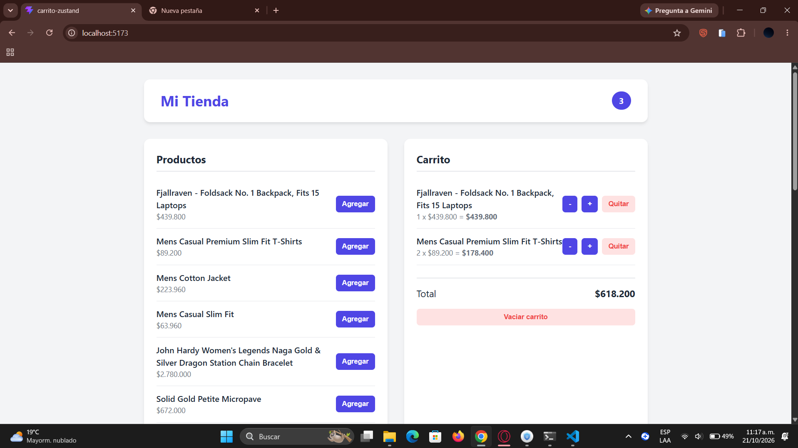

1. ¿Por qué Encabezado se actualiza cuando agregas un producto, si no recibe ninguna prop?
- Porque está suscrito directamente al store global de Zustand mediante un selector (useCarritoStore(state => state.items)). Cuando el estado cambia, Zustand avisa de forma automática al componente para que se vuelva a renderizar con el nuevo valor.

2. ¿Qué tendrías que hacer para lograr lo mismo usando solo useState en App?
- Tendrías que declarar el estado del carrito (carrito, setCarrito) en el componente principal (App) y pasarlo mediante props hacia abajo a ListaProductos y a Encabezado, además de pasar las funciones modificadoras (prop drilling), lo que vuelve el código más rígido y difícil de mantener conforme crece la aplicación.

3. ¿Para qué sirve el selector (state) => state.items al usar el hook? 
- Permite extraer únicamente la porción específica del estado que el componente necesita (items). Esto optimiza el rendimiento porque evita que el componente se vuelva a renderizar por cambios en otras partes del store que no le interesan.

4. ¿Por qué en el store se crean arreglos nuevos con map y filter en lugar de modificar items directamente?
- React depende de la inmutabilidad para detectar cambios de estado. Si se modificara el arreglo directamente con métodos mutables (como push), la referencia en memoria no cambiaría y React no sabría que la interfaz necesita actualizarse.

5. ¿Zustand es parte de React? Explica la diferencia entre una librería propia de React y una del ecosistema.
- No, Zustand no viene incluido en React; es una librería externa creada por la comunidad (del ecosistema). Las herramientas propias de React (useState, useEffect, etc.) vienen integradas de forma nativa, mientras que las del ecosistema son paquetes independientes creados por terceros para resolver necesidades específicas (como la gestión de estado global ligero).

 
